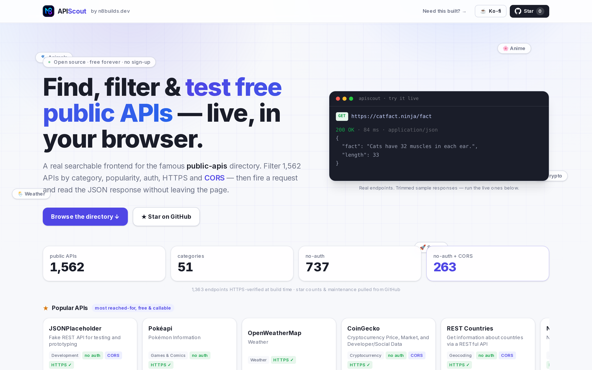
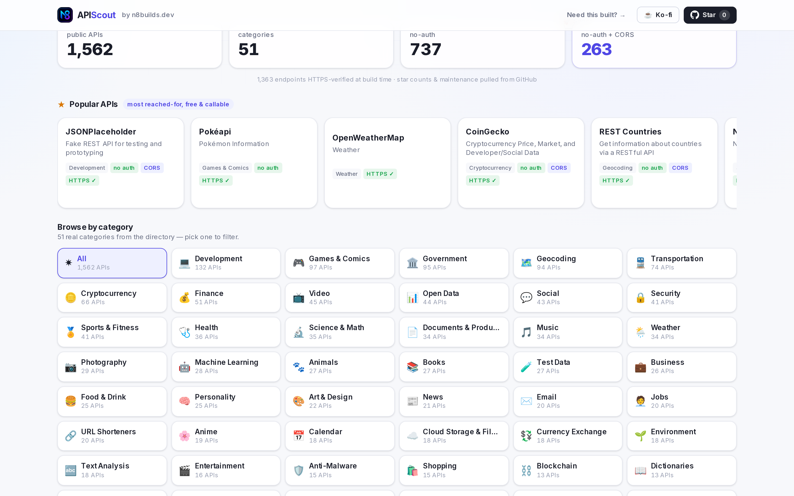
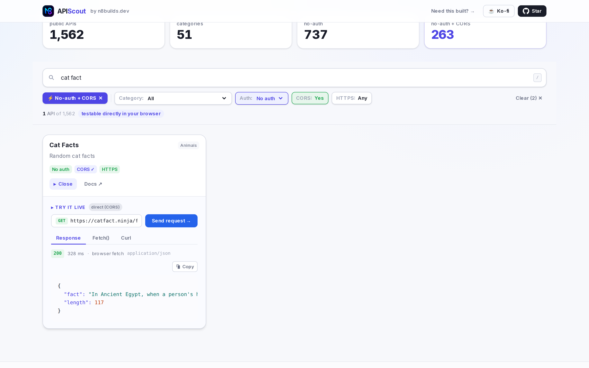

# APIScout — search, filter & test 1,500+ free public APIs in your browser

**A fast, searchable frontend for the [public-apis/public-apis](https://github.com/public-apis/public-apis) directory — with filters for CORS &amp; auth and a live "Try it" playground that runs real requests right in your browser.**

🌐 **Live: [apiscout.vercel.app](https://apiscout.vercel.app)** · ☕ [Support on Ko-fi](https://ko-fi.com/n8watkins) · ⭐ [Star on GitHub](https://github.com/n8watkins/apiscout)



## Why

The `public-apis` README is one of the most-starred repos on GitHub — an incredible community resource. But it's a giant alphabetical markdown table. You can't really *search* it, you can't filter it, and you definitely can't try an endpoint without leaving the page.

APIScout fixes that:

- **Popularity, surfaced first** — a curated popularity rank (blended with real GitHub stars) plus a **"Popular APIs"** strip, so the well-known APIs come first. Sort by **Popular / A–Z / Recently checked**.
- **Categories as a browse mechanism** — all **51 real categories** as clickable tiles with per-category counts, not a buried dropdown.
- **Verified, not just claimed** — a build-time pipeline actually tests each endpoint over HTTPS and pulls GitHub activity, so a "HTTPS ✓ verified" badge means *we confirmed it*. **1,363 / 1,562** endpoints HTTPS-verified this pass; the rest are honestly marked *claimed* or *unconfirmed*.
- **Instant search** across 1,562 APIs by name, description or category
- **Real filters** — category, auth type, HTTPS, and **CORS**
- **The combo nobody else surfaces:** one click finds the **263 no-auth + CORS** APIs you can call straight from browser JavaScript — no key, no backend, no CORS errors
- **A live playground** — fire a real `GET` request and read the syntax-highlighted JSON response in-page
- **Copy-paste snippets** — ready-to-ship `fetch()` and `curl` for every endpoint

> **📖 Want the full design?** See **[HOW_IT_WORKS.md](HOW_IT_WORKS.md)** — architecture, data pipeline, the verification model, the SSRF-hardened proxy internals, the animated hero, SEO and project structure.

## Features

| | |
|---|---|
| ★ **Popularity & sorting** | Curated popularity rank + GitHub stars; a "Popular APIs" strip; sort Popular / A–Z / Recently checked. |
| 🧭 **Category rail** | 51 real categories as clickable tiles with counts — a first-class browse mechanism. |
| ✓ **Verified, not claimed** | Build-time HTTPS verification + GitHub activity. Badges distinguish *verified* / *claimed* / *unconfirmed* — never a bare "HTTPS ✓" we didn't test. |
| 🔎 **Instant client-side search** | Filters 1,500+ APIs as you type — no server round-trips. |
| ⚡ **No-auth + CORS filter** | The unmet need: surface APIs callable directly from the browser. Prominent one-click combo. |
| ▸ **Live "Try it" playground** | Sends a real request and renders the JSON in a syntax-highlighted viewer. |
| 🧩 **Smart routing** | CORS + no-auth APIs are called directly client-side; everything else goes through one SSRF-hardened serverless proxy. |
| 📋 **Snippet generator** | Copy a `fetch()` or `curl` for any endpoint. |
| 🎨 **Animated, premium light UI** | Indigo "dev playground" aesthetic, an animated hero (gradient field + typewriter + live JSON), framer-motion, skeletons, empty states, keyboard-accessible search (`/`), `prefers-reduced-motion` respected. |



## How it works

### The live playground

For an API flagged **CORS-enabled + no-auth**, APIScout calls it **directly from your browser** — exactly how your own frontend code would. You see the true status, latency and response.

For everything else (no CORS headers, or the call fails), the request transparently falls back to a single serverless route at `app/api/proxy/route.ts` that fetches server-side and returns the JSON.

### Proxy security (SSRF hardening)

Because the user supplies the URL to fetch, a naive server-side fetch would be a textbook SSRF primitive. The proxy is hardened the same way the rest of my projects harden user-supplied URL fetching:

- **Scheme allowlist** — `http:` / `https:` only (no `file:`, `gopher:`, …)
- **Private-address blocklist** — loopback, link-local, the cloud metadata endpoint `169.254.169.254`, and RFC1918 / unique-local ranges are all refused
- **Manual redirect re-validation** — redirects are followed by hand and **every hop** is re-checked against the blocklist, so a benign URL can't `302` into your internal network
- **Timeout + capped body read** — requests time out at 8s and responses are read incrementally, stopping at 1 MB so a hostile server can't OOM the function

See [`lib/safefetch.ts`](lib/safefetch.ts) and [`app/api/proxy/route.ts`](app/api/proxy/route.ts).

### The data pipeline & verification

`data/apis.json` is baked at build time from the upstream README, then enriched
with verification data — both committed to git, so the deployed app never blocks
on the network:

```bash
npm run data     # fetch + parse public-apis README → data/apis.json
npm run enrich   # verify: GitHub stars/activity + real HTTPS probe → enrichment.json
npm run data     # re-run to merge fresh enrichment back into apis.json
```

[`scripts/build-data.mjs`](scripts/build-data.mjs) parses every per-category markdown table (`API | Description | Auth | HTTPS | CORS`), normalizes the inconsistent cells, de-dupes, stamps curated popularity ranks, and emits category metadata.

[`scripts/enrich.mjs`](scripts/enrich.mjs) is the honesty pass — concurrency-limited and timeout-bounded over all 1,562 entries: GitHub-repo links get **stars + last-commit date** (token via `gh auth token`); every entry gets a real **HTTPS request** to confirm reachability and that HTTPS actually completes, reconciled with the README's claimed flag. Full details + coverage numbers in **[HOW_IT_WORKS.md](HOW_IT_WORKS.md)**.



## Development

```bash
npm install
npm run dev      # → http://localhost:7690
npm run build    # production build
npm run data     # rebuild data/apis.json from the upstream README
npm run enrich   # run the GitHub + HTTPS verification pass → enrichment.json
npm run shot     # capture README screenshots (needs a running server)
```

See **[HOW_IT_WORKS.md](HOW_IT_WORKS.md)** for the full architecture, data
pipeline, verification model, proxy internals, animated hero and project layout.

**Stack:** Next.js 15 (App Router) · React 19 · TypeScript · Tailwind CSS v4 · framer-motion. Almost entirely static + client-side filtering, with one lightweight serverless route for the proxy. Hosts on Vercel's free tier.

## Credits

- **Data** comes from [**public-apis/public-apis**](https://github.com/public-apis/public-apis) — a community-curated list of free APIs for software & web development, licensed MIT. APIScout is an independent frontend and is not affiliated with that project. All API metadata (auth/HTTPS/CORS flags) is theirs; please contribute corrections upstream.
- Built by **[Nate Watkins](https://n8builds.dev)** · [n8builds.dev](https://n8builds.dev)

If APIScout saved you time, you can [**support it on Ko-fi ☕**](https://ko-fi.com/n8watkins).

<a href="https://ko-fi.com/n8watkins">
  
</a>

---

**Need something like this built?** I build polished web apps and internal tools at **[Appturnity](https://appturnity.com)**. [Let's talk →](https://appturnity.com)

## License

[MIT](LICENSE) © 2026 Nathan Watkins
